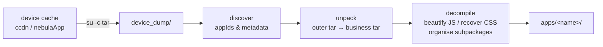

<div align="center">

# alipay-mp-extractor

Extract and decompile Alipay (Android) mini-program packages from a rooted device.

[](https://pypi.org/project/alipay-mp-extractor/)
[](https://pypi.org/project/alipay-mp-extractor/)
[](LICENSE)

English | [简体中文](README.md)

</div>

Alipay caches opened mini-programs on the device as plain tar archives (no
encryption). This tool pulls them out over adb (root required): search by
name, inspect details, export a readable decompiled source tree, optionally
export the plugins an app declares, and unpack the official runtime framework
packages.

## Install

```bash
uvx alipay-mp-extractor list            # run without installing
uv tool install alipay-mp-extractor     # or pip install alipay-mp-extractor
```

From source:

```bash
git clone https://github.com/RYF5584/alipay-mp-extractor
cd alipay-mp-extractor
uv sync
uv run alipay-mp list
```

Requirements: a root-ed adb device (`adb shell su -c id` returns `uid=0`).

## Commands

```bash
alipay-mp sync [--force]              # pull data from the device
alipay-mp list [--json]               # list all mini-programs
alipay-mp search <name>               # by name / appId / plugin alias
alipay-mp info <name|appId>           # details incl. declared plugins
alipay-mp export <name|appId> ...     # export one or more apps
alipay-mp export-all [--kind app]     # export everything
alipay-mp plugins                     # plugin list and who uses them
alipay-mp framework [--export]        # official framework packages
```

Useful `export` options:

| option | description |
|---|---|
| `-o DIR` | output directory, default `<workdir>/apps` |
| `--with-plugins` | also export the plugins declared by the app(s) |
| `--no-beautify` | skip JS formatting, keep raw files |
| `--overwrite` | redo existing export directories |

Device selection (all subcommands):

```bash
--serial <id>                   # pick a USB device
--connect 127.0.0.1:5555        # network device (adb connect)
--adb-host / --adb-port         # remote adb server
--backend auto|adbutils|system  # transport; auto falls back to the system adb binary
```

## Library usage

```python
from alipay_mp_extractor import AlipayMPExtractor

mp = AlipayMPExtractor()                     # USB; network: AlipayMPExtractor(connect="127.0.0.1:5555")
mp.sync()

mp.list()                           # -> list[MiniApp]
mp.search("<name>")                 # -> list[MiniApp]
mp.query("<appId>")                 # -> MiniApp
mp.export("<name>")                 # -> Path
mp.export("<name>", with_plugins=True)   # include declared plugins
mp.plugins()                        # -> list[PluginInfo]
mp.framework()                      # -> list[FrameworkPackage]
mp.export_framework()               # unpack framework packages
```

## Export layout

```
apps/<name>/
├── src/                      compiled bundle (untouched)
└── decompiled/
    ├── PAGES.md              page index: route / subpackage / chunk / worker line
    ├── REPORT.md             backend domains & app info
    ├── app/                  main-package worker + render bundles (beautified)
    ├── subpackages/<name>/   subpackage code and page lists
    ├── shared/               cross-subpackage chunks
    └── *.extracted.css       CSS recovered from the render bundle

plugins/<alias>/               generated with --with-plugins, same structure
```

## How it works

Packages on the device are plain tar archives — no decryption involved;
`root + tar` streams everything out.



- Business packages live at
  `files/Sandbox/*/database/ccdn/caches/app/data/<md5>/0.dc`; the outer tar
  contains `.signature`, `.meta`, `.manifest` and `<appId>.tar`
- In the compiled bundle, `index.worker.js` is the logic layer (webpack),
  `index.js` the render layer (compiled templates with inline CSS), and
  `meta.json` maps pages to files
- Plugin declarations come from `appConfig.json`, cross-checked against the
  container's plugin database

## Skills (Claude Code)

`skills/alipay-mp-extract/` ships a Claude Code skill so an AI assistant can
drive this tool automatically in related tasks:

```bash
# user-level (available in all projects)
mkdir -p ~/.claude/skills
cp -r skills/alipay-mp-extract ~/.claude/skills/

# or project-level
mkdir -p .claude/skills
cp -r skills/alipay-mp-extract .claude/skills/
```

The skill covers trigger conditions, a CLI cheat sheet and library examples;
details live in `skills/alipay-mp-extract/references/`.

## FAQ

**"root required"?** Approve the su prompt for adb on the phone; verify with
`adb shell su -c id`.

**An app is not listed?** Only opened mini-programs are cached. Open it once
in Alipay, then `sync --force`.

**Plugin "not in cache" with `--with-plugins`?** Plugin packages download on
first use; open a page that triggers the plugin, then re-sync.

**Can I get .axml back?** Render templates are compiled to JS functions; the
tool does not reconstruct axml. Class names and text remain greppable in the
beautified JS.

## Contact

- GitHub: [RYF5584](https://github.com/RYF5584)
- WeChat: RSCompanyCEO
- QQ: 1043695584
- Telegram: [ryf5584](https://t.me/ryf5584)

## Keywords

alipay mini program decompiler, alipay mini program extract, alipay miniapp unpack, extract alipay mini program source code, alipay xcx dump, android mini program reverse engineering, 支付宝小程序反编译, 支付宝小程序包提取, 支付宝小程序源码提取

## License

[MIT](LICENSE)
