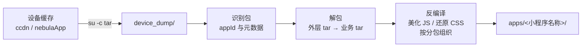

<div align="center">

# alipay-mp-extractor

Extract and decompile Alipay (Android) mini-program packages from a rooted device.

[](https://pypi.org/project/alipay-mp-extractor/)
[](https://pypi.org/project/alipay-mp-extractor/)
[](LICENSE)

[English](README.en.md) | 简体中文

</div>

支付宝把打开过的小程序以 tar 归档的形式缓存在设备上（未加密）。本工具通过 adb（需 root）
把它们找出来：支持按名称搜索、查询详情、导出并反编译成可读的源码树，也能按需导出小程序
声明使用的插件，以及官方运行时框架包。

## 安装

```bash
uvx alipay-mp-extractor list            # 免安装运行
uv tool install alipay-mp-extractor     # 或 pip install alipay-mp-extractor
```

从源码：

```bash
git clone https://github.com/RYF5584/alipay-mp-extractor
cd alipay-mp-extractor
uv sync
uv run alipay-mp list
```

要求：adb 连接的 Android 设备，已 root（`adb shell su -c id` 返回 `uid=0`）。

## 命令

```bash
alipay-mp sync [--force]              # 从设备拉取数据
alipay-mp list [--json]               # 列出所有小程序
alipay-mp search <名称>               # 按名称 / appId / 插件别名搜索
alipay-mp info <名称|appId>           # 查看详情（含插件声明）
alipay-mp export <名称|appId> ...     # 导出，可同时指定多个
alipay-mp export-all [--kind app]     # 导出全部
alipay-mp plugins                     # 插件列表及使用方
alipay-mp framework [--export]        # 官方框架包列表 / 解包
```

`export` 常用参数：

| 参数 | 说明 |
|---|---|
| `-o DIR` | 输出目录，默认 `<workdir>/apps` |
| `--with-plugins` | 同时导出小程序声明的插件源码（默认不导出） |
| `--no-beautify` | 跳过 JS 美化，保留原始文件 |
| `--overwrite` | 重新导出已存在的目录 |

设备选择（所有子命令通用）：

```bash
--serial <序列号>                # 指定 USB 设备
--connect 127.0.0.1:5555        # 连接网络设备（adb connect）
--adb-host / --adb-port         # 远程 adb server 地址
--backend auto|adbutils|system  # 传输后端，auto 默认（adbutils 失败自动改用系统 adb）
```

## 库调用

```python
from alipay_mp_extractor import AlipayMPExtractor

mp = AlipayMPExtractor()                     # USB；网络设备: AlipayMPExtractor(connect="127.0.0.1:5555")
mp.sync()

mp.list()                           # -> list[MiniApp]
mp.search("<名称>")                  # -> list[MiniApp]
mp.query("<appId>")                 # -> MiniApp
mp.export("<名称>")                  # -> Path
mp.export("<名称>", with_plugins=True)   # 连同声明的插件一起导出
mp.plugins()                        # -> list[PluginInfo]
mp.framework()                      # -> list[FrameworkPackage]
mp.export_framework()               # 解包官方框架包
```

## 导出结构

```
apps/<小程序名称>/
├── src/                      原始编译产物
└── decompiled/
    ├── PAGES.md              页面索引：路由 / 分包 / 渲染文件 / worker 行号
    ├── REPORT.md             请求域名与应用信息
    ├── app/                  主包逻辑层与渲染层（美化后）
    ├── subpackages/<分包>/    分包代码及页面清单
    ├── shared/               跨分包共享代码
    └── *.extracted.css       从渲染层还原的样式表

plugins/<插件别名>/             --with-plugins 时生成，结构与上相同
```

## 原理

设备上的包均为标准 tar 归档，无需解密：`root + tar` 流式导出即可。



- 业务包位于 `files/Sandbox/*/database/ccdn/caches/app/data/<md5>/0.dc`，
  外层 tar 内含 `.signature`、`.meta`、`.manifest` 和 `<appId>.tar`
- 编译产物中 `index.worker.js` 为逻辑层（webpack 打包），`index.js` 为渲染层
  （模板编译产物，内联 CSS），`meta.json` 描述页面到文件的映射
- 插件声明来自 `appConfig.json`，并与容器数据库中的插件表交叉验证

## Skills（Claude Code）

`skills/alipay-mp-extract/` 提供了一份 Claude Code 技能，安装后 AI 助手在相关任务中会自动调用本工具：

```bash
# 用户级安装（所有项目可用）
mkdir -p ~/.claude/skills
cp -r skills/alipay-mp-extract ~/.claude/skills/

# 或项目级安装
mkdir -p .claude/skills
cp -r skills/alipay-mp-extract .claude/skills/
```

技能包含触发时机、CLI 速查与库调用示例，细节文档见 `skills/alipay-mp-extract/references/`。

## 常见问题

**提示 root required？** 在手机上确认已授权 adb 的 su 请求，可用
`adb shell su -c id` 自检。

**搜不到某个小程序？** 设备上只保留打开过的小程序，先在支付宝里打开它，再执行
`sync --force`。

**`--with-plugins` 时提示插件不在缓存？** 插件包在首次触发时才下载，打开会用到该
插件的页面后重新 `sync`。

**能还原 .axml 吗？** 渲染层模板已编译为 JS 函数，工具不反向生成 axml；类名、文案
等仍可在美化后的 JS 中检索。

## 联系方式

- GitHub：[RYF5584](https://github.com/RYF5584)
- WeChat：RSCompanyCEO
- QQ：1043695584
- Telegram：[ryf5584](https://t.me/ryf5584)

## 关键词

支付宝小程序反编译、支付宝小程序包提取、支付宝小程序源码提取、支付宝小程序解包、支付宝小程序源码导出、支付宝插件提取、Alipay mini program decompile、alipay miniapp unpack、extract alipay mini program source code、Android mini program dump

## License

[MIT](LICENSE)
